<a href="https://linkedin.com/in/nbroy">LinkedIn</a> &nbsp;·&nbsp; <a href="https://github.com/NefariousNiru?tab=repositories">Repositories</a> &nbsp;·&nbsp; <a href="https://leetcode.com/u/Nefarious_Nzx/">LeetCode</a>

## 👋 A little about me

I'm a senior software engineer with five years of experience building distributed systems, high-scale backend platforms and AI-powered software. I'm drawn to the problems beneath the application layer: how systems coordinate, handle failure, move data efficiently and stay predictable under load.

I enjoy exploring systems from first principles, whether that means building a distributed storage engine, optimizing graph workloads in C++, or designing reliable infrastructure around AI models.

**M.S. Computer Science** · University of Georgia · 4.0/4.0 GPA

## Currently building @ UGA

**Senior Software Engineer** · College of Pharmacy, University of Georgia · Nov 2026 – Present

I lead AI-powered educational technology development across 16 project initiatives, working with faculty and domain experts to turn ideas into dependable software. My work spans architecture, hands-on engineering, platform modernization, and improving how we develop, test and deliver software.

## Engineering in practice

Previously, I helped build an AI grading platform for **1K+ users** at UGA, reducing end-to-end latency by **75%** and LLM token costs by **50%**. At JourneyTMS, I reduced scheduling runtime by **98%**. At Wizork, I helped scale a classroom ERP platform from **1K to 50K users** and built event-driven services and real-time messaging infrastructure.

## Selected work

A collection of systems I've built to explore interesting engineering problems.

### [Keyflow](https://github.com/NefariousNiru/keyflow) ↗

A secure, local-first Android-to-Windows remote keyboard, exploring device identity, mutual TLS and low-latency input.

Android · .NET · Secure networking

### [GPUPath](https://github.com/NefariousNiru/gpupath) ↗

Native graph traversal and batched shortest-path queries for large graphs. Developing CUDA many-to-many shortest-path kernels.

**65× speedup** over pure-Python NetworkX on graphs with 1M+ edges. Targeting an additional 10× GPU throughput over the CPU baseline.

C++ · CUDA · pybind11

### [Graph-based Social Platform](https://github.com/NefariousNiru/social-media) ↗

An event-driven social backend built around graph relationships, asynchronous processing and scalability.

**3K read RPS · 1.2K write RPS** · p95 &lt;220 ms.

Spring Boot · Neo4j · Kafka

### [DynamoLite](https://github.com/NefariousNiru/dynamo-lite) ↗

A Dynamo-inspired fault-tolerant key-value store with consistent hashing, vector clocks and Merkle-tree anti-entropy repair.

**40% improvement** in replica convergence.

Java · gRPC · Distributed storage

### [PaperTrail AI](https://github.com/NefariousNiru/papertrail-ai-backend) ↗

AI-assisted research citation evaluation combining semantic retrieval, LLM ranking and real-time streaming.

FastAPI · Redis · Retrieval · LLMs

## AI / ML explorations

Beyond production AI, I enjoy experimenting with model architectures, compression and statistical learning.

**[VGG Pruning](https://github.com/NefariousNiru/pruning-vgg)**  
Neural network pruning and compression.

**[Custom CNN / ResNet-20](https://github.com/NefariousNiru/custom-CNN-cifar-10-resnet-20)**  
CIFAR-10 image classification.

**[Neural Networks Comparative Analysis](https://github.com/NefariousNiru/Neural_Nets_Comparative_Analysis)**  
Comparative neural network experiments.

**[Dynamic-SARIMAX](https://github.com/NefariousNiru/dynamic-sarimax)**  
Time-series forecasting; package developer and maintainer.

**[ScalaTion & ScalaTionPy](https://github.com/scalation)**  
Open-source scientific computing and data science.

## Engineering toolkit

| | |
| :-- | :-- |
| **Backend & systems** | Python, Java, Go, C++, FastAPI, Spring Boot, gRPC, WebSockets |
| **Data & messaging** | PostgreSQL, Redis, Kafka, MongoDB, Neo4j, Elasticsearch |
| **Infrastructure** | AWS, Docker, Kubernetes, Linux, CI/CD |
| **AI engineering** | LLM orchestration, RAG, LangChain, LangGraph, agentic systems |

## 🌱 Currently learning

**Rust** — ownership, memory safety and concurrent systems programming.  
**AI** — model internals, efficient inference and scalable AI infrastructure.  
**Distributed systems** — storage engines, consistency protocols, fault tolerance and performance at scale.

Always up for a conversation about systems architecture, AI, or an interesting engineering problem. <a href="https://linkedin.com/in/nbroy">Let's connect.</a>

